::: {.cover}
# Linux Laboratory

## Part 1 & Part 2

**Course:** GIK2NV – Data storage and management technologies

**Date:** 2026-10-16

| Students |
|---|
| Ali Hasan |
| Bilal Ahmed Adem |
| Hussein Mustafa |
| Merat Bakoyan |

**Video presentation:** uploaded separately on Canvas
:::

# Introduction

In this lab we act as Linux administrators for a company. The company has three new departments: **Engineering**, **Sales** and **HR**.

- In **Part 1** we create folders, groups, users and permissions for the departments, one command at a time.
- In **Part 2** we write a Bash script that does the same kind of work automatically, for any user and group name.

**Environment:** Ubuntu Linux. All commands are run as the `root` user (on a normal account, put `sudo` in front of each command).

**Names we used:**

| Department | Group | Admin | Users |
|---|---|---|---|
| Engineering | Engineering | eng_admin | eng_user1, eng_user2 |
| Sales | Sales | sales_admin | sales_user1, sales_user2 |
| HR | HR | hr_admin | hr_user1, hr_user2 |

# Part 1 – User management

## Task 1: Create a directory at the root (/) for each department

**How we did it:** We go to the root of the file system with `cd /`. Then we create one folder per department with `mkdir`. Each folder has the same name as its department.

**Code:**

```
cd /
mkdir /Engineering /Sales /HR
```

**Verification:** `ls -ld` shows that the three folders exist under `/`.

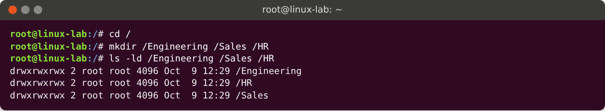

## Task 2: Create a group for each department

**How we did it:** We create one group per department with `groupadd`. Each group has the same name as its department.

**Code:**

```
groupadd Engineering
groupadd Sales
groupadd HR
```

**Verification:** `getent group` shows that the groups exist in `/etc/group`.

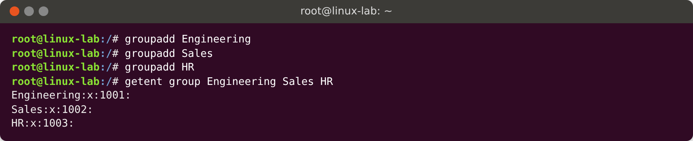

## Task 3: Create an administrative user for each department

**How we did it:** We create one admin per department with `useradd`:

- `-m` creates a home folder for the user.
- `-s /bin/bash` gives the user a **Bash login shell** (3a).
- `-g <group>` makes the department group the user's **primary group** (3b).

**Code:**

```
useradd -m -s /bin/bash -g Engineering eng_admin
useradd -m -s /bin/bash -g Sales sales_admin
useradd -m -s /bin/bash -g HR hr_admin
```

**Verification:**

- `id` shows that the primary group (`gid`) is the department group.
- `/etc/passwd` shows that the login shell is `/bin/bash`.

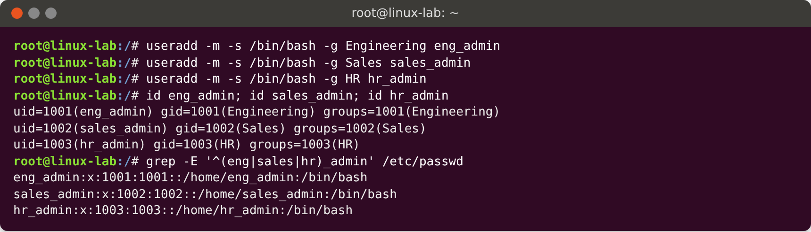

## Task 4: Create two additional users for each department

**How we did it:** We create two normal users per department, with the same options as the admins: a Bash login shell (4a) and the department as primary group (4b).

**Code:**

```
useradd -m -s /bin/bash -g Engineering eng_user1
useradd -m -s /bin/bash -g Engineering eng_user2
useradd -m -s /bin/bash -g Sales sales_user1
useradd -m -s /bin/bash -g Sales sales_user2
useradd -m -s /bin/bash -g HR hr_user1
useradd -m -s /bin/bash -g HR hr_user2
```

**Verification:** `id` shows the right primary group for every user, and `/etc/passwd` shows `/bin/bash` for all of them.

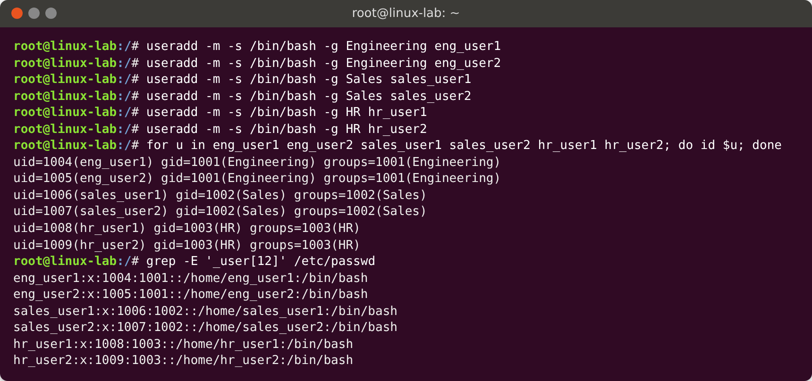

## Task 5: Secure the department directories

### 5a – Owner and group

**How we did it:** `chown user:group` sets the owner and the group of a folder in one command. The department admin becomes the owner, and the department group becomes the group owner.

**Code:**

```
chown eng_admin:Engineering /Engineering
chown sales_admin:Sales /Sales
chown hr_admin:HR /HR
```

**Verification:** `ls -ld` shows the new owner and group.

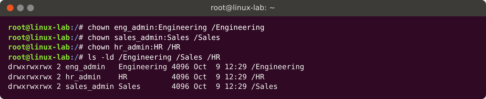

### 5b–5e – Permissions

**How we did it:** One command covers all the permission rules: `chmod 1770`. Each digit means:

| Digit | Meaning | Task |
|---|---|---|
| **1** | Sticky bit: only the owner of a file can delete it | 5c |
| **7** | Owner (admin): read, write and execute, which is full access | 5b |
| **7** | Group (department users): read, write and execute, which is full access | 5d |
| **0** | Others: no permissions at all | 5e |

**Code:**

```
chmod 1770 /Engineering /Sales /HR
```

**Verification:** `ls -ld` shows `drwxrwx--T`:

- `rwx` for the owner,
- `rwx` for the group,
- `---` for others,
- `T` at the end, which means the sticky bit is on.

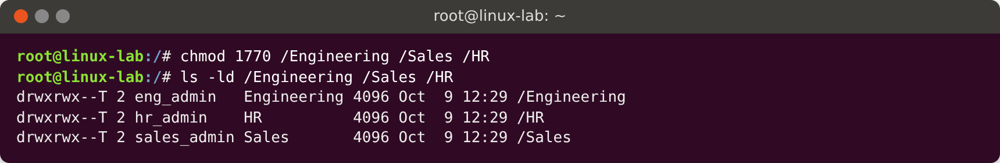

### Test of task 5

**How we tested it:** We use `su - <user> -c '<command>'` to run a command as another user.

1. **eng_user1** creates a file in `/Engineering`. ✅ This works, so users have full access (5d).
2. **eng_user2** tries to delete eng_user1's file. ❌ *Operation not permitted*. The sticky bit works (5c).
3. **eng_user1** deletes their own file. ✅ This works.
4. **sales_user1** and **hr_admin** try to use folders from other departments. ❌ *Permission denied* (5e).

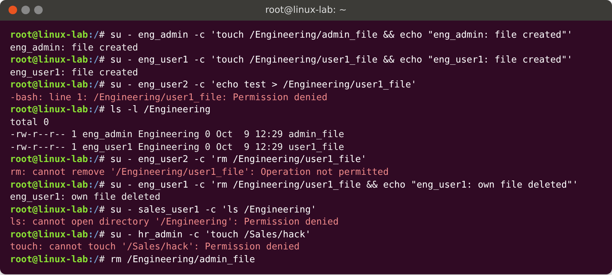

## Task 6: Create a document in each department directory

**How we did it:**

1. `echo` writes the sentence into `confidential.txt` in each folder. The file has exactly one line (6b).
2. `chown` gives the file the same owner and group as its folder (6a).
3. `chmod 640` sets who can do what (6c):

| Digit | Who | Permission |
|---|---|---|
| **6** | Owner (admin) | Read and write: only the admin can change the file |
| **4** | Group (department) | Read only |
| **0** | Others | No permissions |

**Code:**

```
for d in Engineering Sales HR; do
  echo "This file contains confidential information for the department." > /$d/confidential.txt
done
chown eng_admin:Engineering /Engineering/confidential.txt
chown sales_admin:Sales /Sales/confidential.txt
chown hr_admin:HR /HR/confidential.txt
chmod 640 /Engineering/confidential.txt /Sales/confidential.txt /HR/confidential.txt
```

**Verification:** `ls -l` shows `-rw-r-----` and the right owner for every file, and `cat` shows the one line of text.

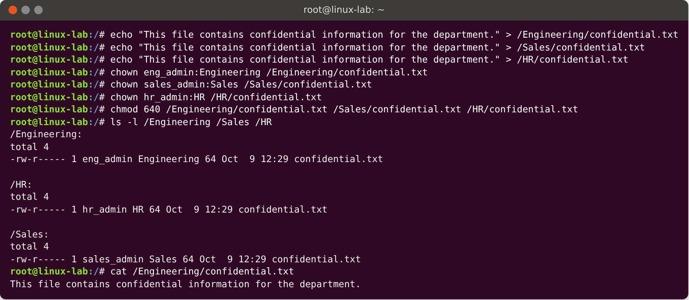

### Test of task 6

1. A department user **can read** the file. ✅
2. A department user **cannot change** it. ❌ *Permission denied*
3. The admin **can change** it. ✅
4. Users from other departments **cannot read** it. ❌ *Permission denied*

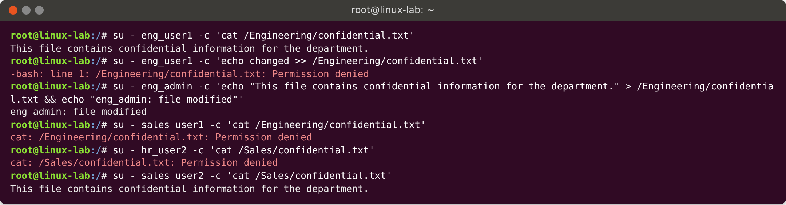

# Part 2 – User management script

## How the script works

Our script is called `usermgmt.sh`. It asks the administrator for a group name, a username and a password, so **no names are hardcoded**. It follows a logical order:

- The group must exist before the user, because it becomes the user's primary group.
- The user must exist before we can give them a folder.

The script uses the special variable **`$?`**. It holds the result (exit code) of the last command: **0 means success**, and any other number means it failed. We use it to check whether a name already exists and whether each command worked.

**Step by step:**

- **Start:** The script checks that it is run as root. If not, it stops with an error.
- **(a) Create a new group:** The script asks for a group name. `getent group <name>` checks whether the group already exists. If `$?` is 0, the group exists, so the script shows an error and asks for another name. If the name is free, `groupadd` creates the group.
- **(b) Create a new user:** The same idea with `getent passwd <name>`. If the name is free, `useradd -m -s /bin/bash -g <group> <user>` creates the user with a Bash login shell and the new group as primary group.
- **(c) Create a password:** The password is typed twice with `read -s`, so it is hidden. If the two passwords are different or empty, the script asks again. `chpasswd` saves the password.
- **(d) Group membership:** `usermod -aG <group> <user>` adds the user as a member of the new group.
- **(e) Create a directory:** `mkdir /<username>` creates a folder at the root with the same name as the user.
- **(f) Ownership:** `chown <user>:<group> /<username>` gives the folder to the new user and group.
- **(g + h) Permissions:** `chmod 1770 /<username>` gives full control to the owner and the group, no access to others, and sets the sticky bit so only the owner of a file can delete it.
- **(i) Executable:** We make the script executable with `chmod +x usermgmt.sh` and run it with `./usermgmt.sh`.

At the end, the script prints a summary with `id`, `/etc/passwd` and `ls -ld`, which shows that everything worked.

## The script

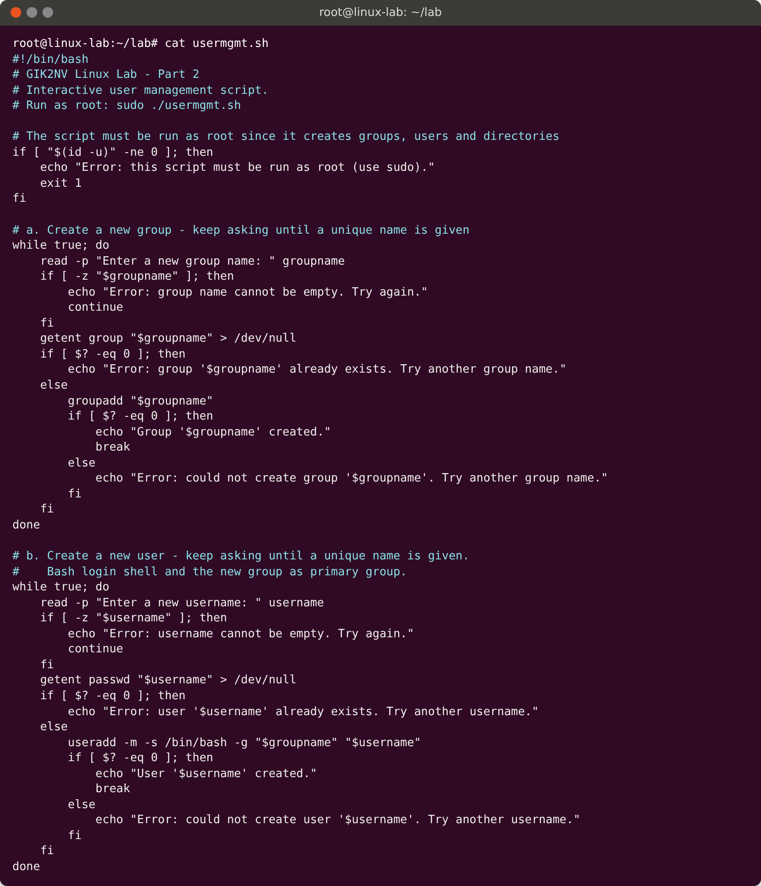

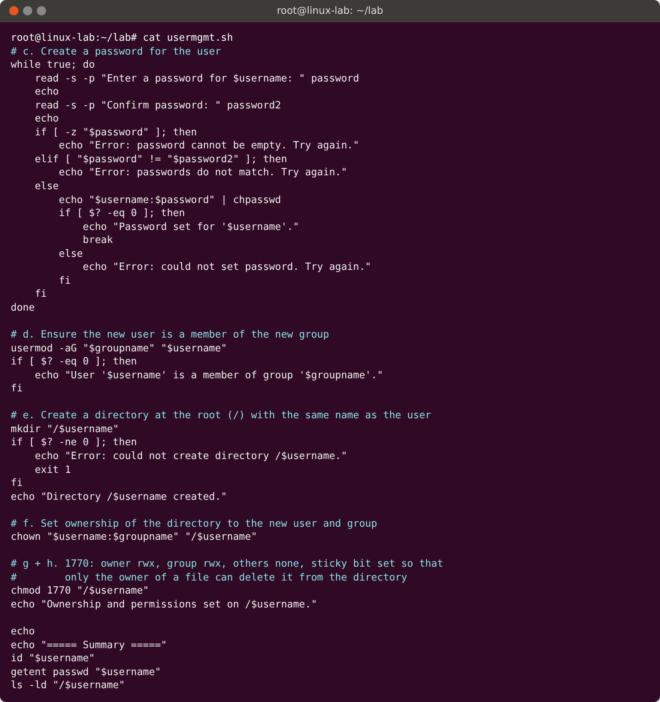

## Tests

### Test 1 – Making the script executable (i)

Before `chmod +x`, the file is `-rw-r--r--`, so it cannot run. After `chmod +x`, it is `-rwxr-xr-x`, so it is executable.

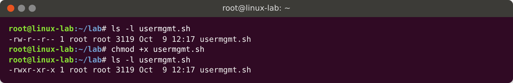

### Test 2 – Wrong input and then correct input (a–h)

In this test we try every error case:

| We typed | What happened | Task |
|---|---|---|
| `HR` | Error: the group already exists, so the script asks again | a |
| `Marketing` | The group is created | a |
| `eng_admin` | Error: the user already exists, so the script asks again | b |
| `anna` | The user is created | b |
| Two different passwords | Error: the passwords do not match, so the script asks again | c |
| The same password twice | The password is set | c |

Then the script makes anna a member of Marketing (d), creates `/anna` (e), sets owner `anna:Marketing` (f) and sets the permissions `drwxrwx--T` (g, h).

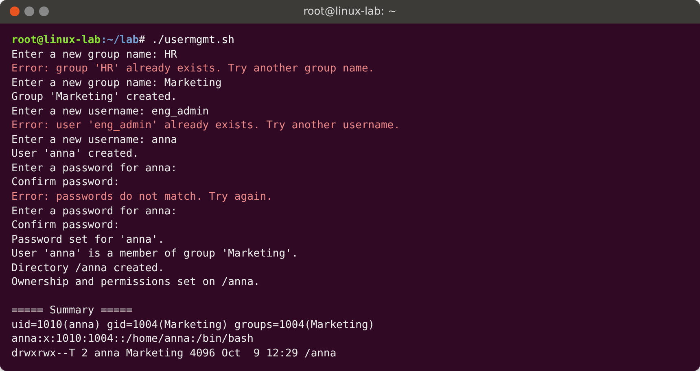

### Test 3 – Checking the result

1. `/etc/group` shows that **anna is a member of Marketing** (a, d).
2. `id` and `/etc/passwd` show that the **primary group is Marketing** and the **shell is /bin/bash** (b).
3. `/etc/shadow` shows that **a password is saved** (c).
4. `/anna` exists (e), is owned by **anna:Marketing** (f) and has **drwxrwx--T** (g, h).
5. anna **can create files** in her folder, and **other users are denied**.

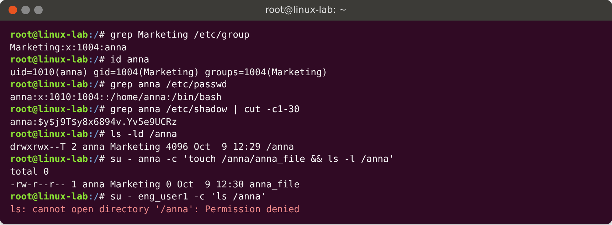

### Test 4 – Running the script again with other names

This shows that the script works for **any names**. It also tests an empty group name, and it shows that `Marketing` and `anna` are now rejected because they already exist.

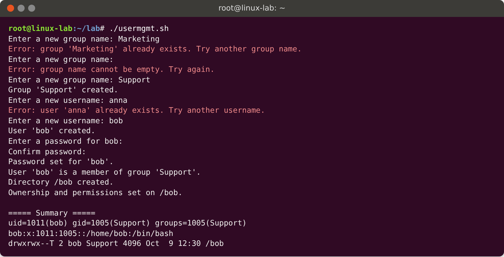

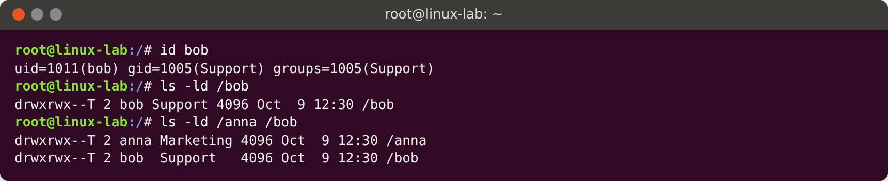

# Conclusion

**Part 1:** Every department has its own folder, owned by its admin and its group. Everyone in the department has full access, but files can only be deleted by their owner (sticky bit). Users from other departments have no access. Each folder has a confidential file that the department can read but only the admin can change.

**Part 2:** Our script does the same work automatically for any group and user name. It checks for duplicates with `getent` and `$?`, asks again when something is wrong, and always creates a correctly set up user and folder.

All tests worked as expected. The video presentation shows every step live.
